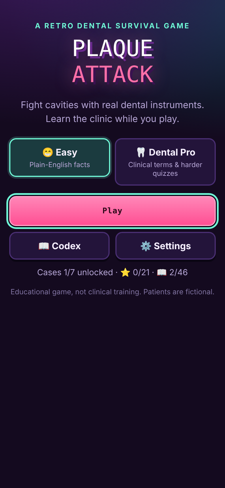
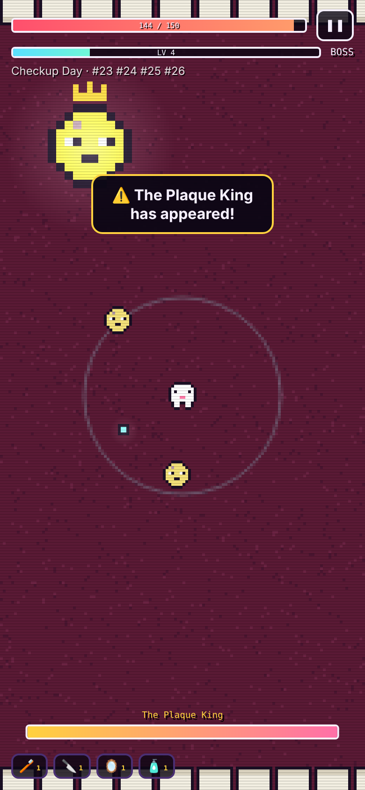

# 🦷 Plaque Attack

**A retro dental survival game that teaches real dentistry.** You fight plaque, tartar, cavities and gum disease inside a pixel-art mouth using real dental instruments. Then you prove what you learned by putting the actual procedure in order and answering a quick quiz.

[](https://plaque-attack.onrender.com)
[](https://github.com/GaretJax6905/plaque-attack/actions/workflows/checks.yml)

<p align="center">
  
  &nbsp;&nbsp;
  
</p>

It works on phones and computers, installs to your home screen, and plays offline.

| | |
| --- | --- |
| **Front end** | Vanilla JavaScript ES modules (no build step), Canvas 2D pixel renderer, Web Audio API, PWA with offline service worker |
| **Architecture** | Pure, DOM-free game engine with a seeded RNG, kept separate from rendering, input, audio and UI |
| **Quality** | 32 automated tests run in real Chromium: module-level logic tests, plus 9 full UI journeys on a phone-sized screen. Black and Pylint too. All run in GitHub Actions |
| **Deploy** | Render static site, auto-deployed from `main` |

## How it plays

- **Appointments:** 7 patient cases, each a real diagnosis on real teeth:

  | # | Case | Diagnosis | Teeth |
  | --- | --- | --- | --- |
  | 1 | Checkup Day | Plaque-induced gingivitis | #23–26 |
  | 2 | Tartar Trouble | Supragingival calculus, lingual of mandibular anteriors | #23–26 |
  | 3 | Sugar Rush | Class I caries, occlusal | #30 |
  | 4 | Between the Lines | Class II caries, MO, found on a bitewing | #19 |
  | 5 | Deep Pockets | Periodontitis, 5–6 mm pockets | #30–31 |
  | 6 | Hot & Cold | Irreversible pulpitis (root canal) | #3 |
  | 7 | Wisdom Showdown | Impacted third molar (extraction) | #32 |

- **Survive about 2 minutes** of waves, then beat the case's boss. Runs are short on purpose, so a whole case fits a bus or train ride.
- **Move only:** drag anywhere on a phone, or use WASD / arrow keys. Your instruments attack automatically.
- **Level up** to choose instruments. Each one behaves like its real job:
  - The **sickle scaler** shreds tartar.
  - The **Gracey curet** reaches germs below the gumline.
  - The **mouth mirror** reveals hidden cavities.
  - The **probe** "measures" enemies so they take more damage.
  - The **curing light** stuns in a blue cone.
  - **Fluoride varnish** protects you.
  - …and more.
- **After the boss:** put the real treatment in order (Dental Pro), then take a 3-question quiz.
- **Earn ⭐⭐⭐:**
  1. Treat the patient.
  2. Get at least 2 of 3 quiz questions right.
  3. Make at least 2 clinically indicated instrument choices (Pro mode also needs the procedure in the correct order).

### Two modes

| | 😁 Easy | 🦷 Dental Pro |
| --- | --- | --- |
| Text | Plain-English explanations | Clinical terminology and detail |
| Instrument hints | ✓ marks instruments that fit the case | No hints: feedback after each choice |
| After the boss | Walk-through of the real appointment | Put the procedure steps in order, with corrections |
| Quiz | General dental-health questions | Universal/FDI numbering, G.V. Black classes, instrument design (e.g. Gracey 11/12 vs 13/14), anesthesia, materials, endodontics, oral surgery |

### Codex

There are 46 entries covering instruments, conditions, tooth anatomy, Universal and FDI numbering, tooth surfaces and G.V. Black's classes. Each entry has an Easy and a Dental Pro explanation, and entries unlock as you meet them.

### Saving

Progress saves automatically in the browser. **Settings → Save code** lets you copy your progress to another device.

## Accuracy

The content is written as short educational summaries of well-established basics: instrument designs and uses, numbering systems, the G.V. Black classification, common anesthetics, and standard procedure sequences. The key facts were cross-checked against dental-hygiene references. It is **not clinical training**, and all patients are fictional. Suggestions from dental students and professionals are welcome: open an issue.

Further reading:
- Wilkins' *Clinical Practice of the Dental Hygienist*
- Nield-Gehrig's *Fundamentals of Periodontal Instrumentation*
- Sturdevant's *Art and Science of Operative Dentistry*

## Tech

- **Front end:** vanilla JavaScript ES modules with no build step, plus Canvas 2D.
- **Graphics:** drawn at low resolution and scaled up for crisp pixels, with an additive glow and CRT scanline pass on top.
- **Audio:** chiptune music and sound effects generated live with the WebAudio API.
- **Offline:** a web app manifest plus a service worker cache the game for offline play.
- **Engine:** `js/engine.js` is a pure simulation (no DOM), so game rules are tested headlessly with a seeded random number generator.

| Folder / file | What's in it |
| --- | --- |
| `js/data/` | Dental content: teeth, instruments, conditions, cases, quiz bank |
| `js/engine.js` | Gameplay rules |
| `js/render.js` | Pixel renderer |
| `js/input.js` | Touch joystick and keyboard |
| `js/audio.js` | Music and sound effects |
| `js/save.js` | Progress and save codes |
| `js/codex.js` | Codex catalog |
| `js/main.js` | Screens and game flow |

## Front-end highlights

- **Mobile-first.** The game is designed and tested at phone size (390×844) with a floating touch joystick. Runs are about 2 minutes, so a whole case fits a bus ride.
- **Testable architecture.** `js/engine.js` has no DOM access, so the game rules run headlessly with a seeded random number generator. Rendering, input, audio and screens are separate modules.
- **Accessible UI.** Modals move focus to their first button, toasts are announced through an `aria-live` region, and `prefers-reduced-motion` turns off animations and transitions.
- **Offline-first PWA.** A manifest and service worker cache the whole game, so it installs and plays without a connection.
- **Crisp retro graphics.** Each frame is drawn at low resolution and scaled up, with an additive glow and CRT scanline pass on top.
- **Portable progress.** Progress autosaves in the browser, and a save code moves it to another device. A browser test proves this works between two separate browsers.

## How I worked: AI-assisted, test-verified

I made Plaque Attack for my web applications course, working with Claude (an AI coding assistant) as a pair programmer. I chose the dental concept, playtested it, and decided what shipped.

Educational content is only useful if it's correct, so accuracy is enforced by tests, not just reviewed:

- **Tooth numbering.** All 32 teeth are checked against an independent Universal ↔ FDI table.
- **Content completeness.** Every case, quiz question and Codex entry is checked for missing fields in both modes.
- **Full journeys.** Easy and Pro cases are played start to finish in real Chromium, including wrong-order corrections.
- **Gate.** GitHub Actions runs all of this on every push and pull request.

## Run it locally (WSL/Ubuntu, Python 3.12)

```sh
python3.12 -m venv .venv
.venv/bin/python -m pip install -r requirements.txt
.venv/bin/python -m playwright install --with-deps chromium
python3 -m http.server 8000
```

Open http://127.0.0.1:8000.

## Checks

```sh
.venv/bin/python check.py
```

This runs Black and Pylint, then two groups of Chromium tests:

- **Logic tests:** the game's JavaScript modules imported and checked in the browser.
  - All 32 teeth checked against an independent Universal/FDI table.
  - Every case, quiz question and Codex entry checked for completeness.
  - Instrument bonuses, boss timing, damage reduction, and save/restore.
- **Full UI journeys on a phone-sized screen:**
  - Easy and Pro cases, start to finish.
  - Wrong-order corrections.
  - Level-ups and touch dragging.
  - Losing and retrying.
  - The Codex.
  - Moving a save code between two separate browsers.

GitHub Actions runs the same checks on every PR and Render deploys `main` automatically.

## Author

**Thomas Moylan** · IT student at NJIT, building toward front-end engineering · [@GaretJax6905](https://github.com/GaretJax6905)

More projects: [RPS Chaos](https://github.com/GaretJax6905/rps-chaos) (boss-rush RPS with a learning AI and online play) · [Neon Swarm](https://github.com/GaretJax6905/neon-swarm) (Canvas arena shooter) · [MoodWave](https://github.com/GaretJax6905/moodwave) (Web Audio synthesizer and visualizer)
